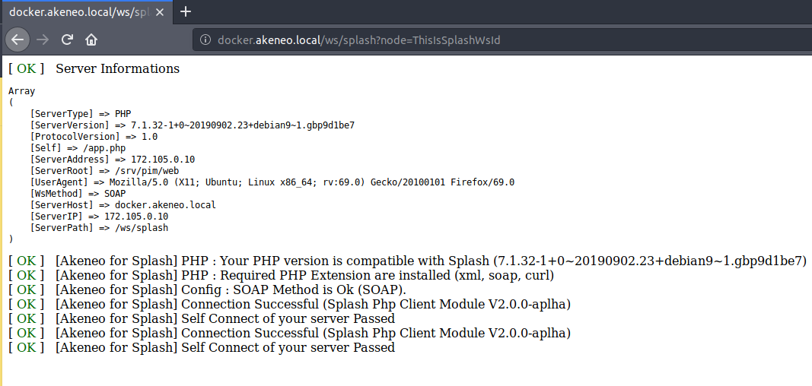
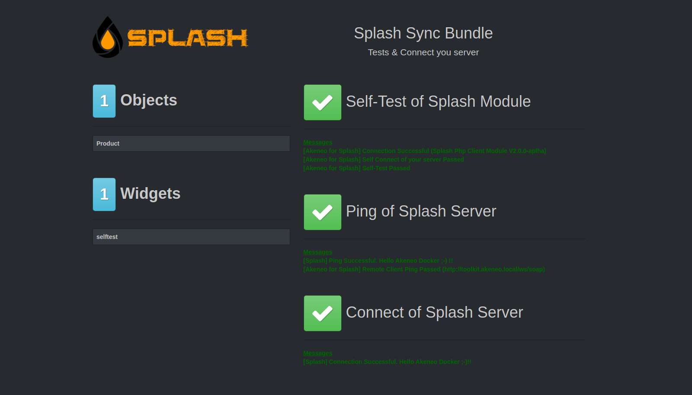

### Activate Splash Bundle in your Application

Now that bundle is installed and configured, you have to activate it in Symfony.

Two bundles need to be activated, your Akeneo Bundle, plus our foundation bundle for Symfony.

```php
// config/bundles.php
return [
    // ...
    Splash\Bundle\SplashBundle::class           => ['all' => true],
    Splash\Akeneo\SplashAkeneoBundle::class     => ['all' => true],
];
```

### Clear Cache & Restart your application

To ensure changes are done, you need to flush the cache.

Diplomatic method...
```bash
$ php bin/console --env=prod cache:clear --no-warmup
```

Less Diplomatic method...
```bash
$ rm -Rf var/cache/*
```

### Test & Declare your server

At this step, your akeneo application should work normally!

Let's check Splash is correctly installed & declare our server configuration to Splash.

In your browser, go to **https://akeneo.exemple.com/ws/splash?node=ThisIsSplashWsId**



> [!NOTE]
> This must work even if you are disconnected from Akeneo.

### See more details ?

Now sign in Akeneo, and go to **https://akeneo.exemple.com/ws/splash-test?node=ThisIsSplashWsId**



> [!NOTE]
> This must work **only** if you are connected to Akeneo.
