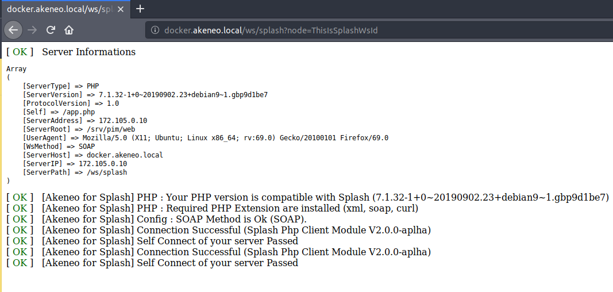
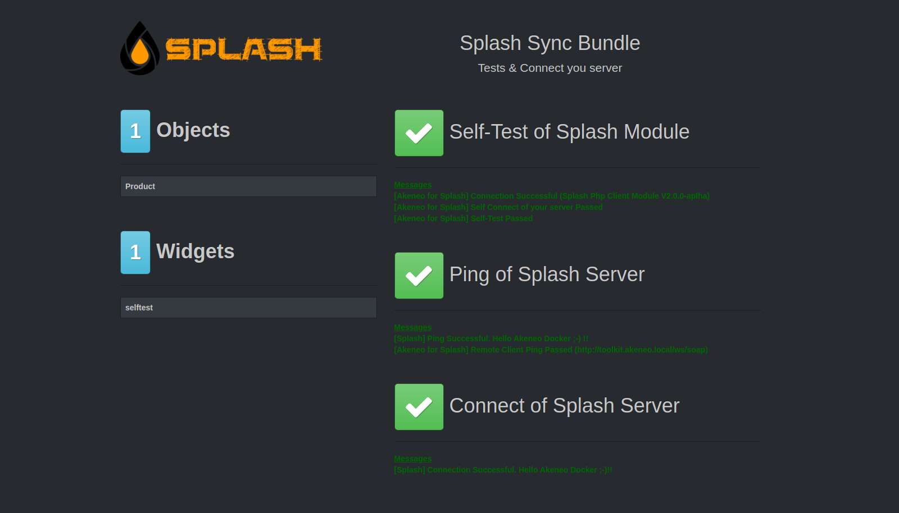

### Activer Splash Bundle dans le kernel de votre application

Maintenant que ce paquet est installé et configuré, vous devez l'activer sur le kernel Symfony.

Deux bundles doivent être activés, votre bundle Akeneo, ainsi que notre bundle de base pour Symfony.

```php

    /**
     * Registers your custom bundles
     *
     * @return array
     */
    protected function registerProjectBundles()
    {
        return array(
            new \Splash\Bundle\SplashBundle(),
            new \Splash\Akeneo\SplashAkeneoBundle(),
        );
    }

```


### Effacer le cache et redémarrer votre application

Pour vous assurer que les modifications sont effectuées, vous devez vider le cache.

Méthode diplomate...
```bash
$ php bin/console --env=prod cache:clear --no-warmup
```

Méthode moins diplomate...
```bash
$ rm -Rf var/cache/*
```

### Testez et déclarez votre serveur

A ce stade, votre application Akeneo devrait fonctionner normalement!

Vérifions que Splash est correctement installé et déclarons la configuration de notre serveur à Splash.

Dans votre navigateur, accédez à **https://akeneo.exemple.com/ws/splash?node=ThisIsSplashWsId**



> [!NOTE]
> Cela doit fonctionner même si vous n'êtes pas connecté à Akeneo.

### Voir plus de détails?

Connectez-vous maintenant à Akeneo et accédez à l'adresse suivante: **https://akeneo.exemple.com/ws/splash-test?node=ThisIsSplashWsId**



> [!NOTE]
> Cela doit fonctionner **uniquement** si vous êtes connecté à Akeneo.
